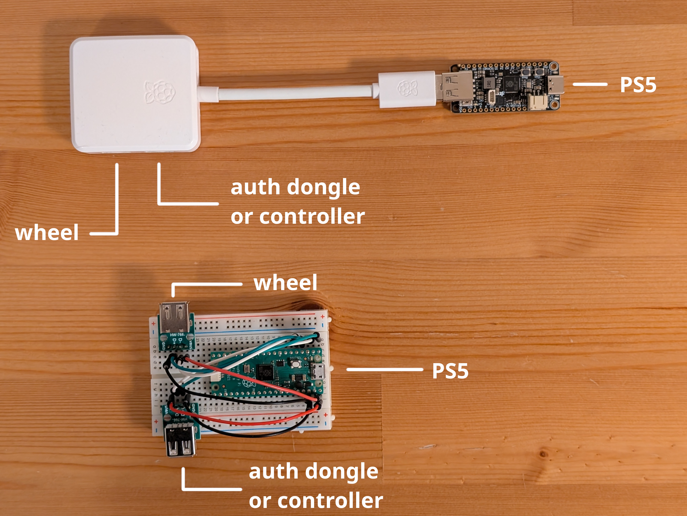

# PS5 adapter for old Logitech wheels

This is an adapter that lets you use older Logitech wheels like the Driving Force Pro, G25 or G27 with PS5 games like Gran Turismo 7. It requires an additional auth dongle or controller belonging to the ["specialty peripheral"](https://blog.playstation.com/2020/08/03/playstation-5-answering-your-questions-on-compatible-ps4-peripherals-accessories/) class to satisfy the console's authentication requirements.

You will need either:

* Raspberry Pi Pico or Pico 2.
* Two USB Type A female connectors. Either extension cables cut in half or breakout boards.

or:

* A board with a built-in USB Type A host port like the [Adafruit Feather RP2040 with USB host](https://www.adafruit.com/product/5723) or the [Waveshare RP2350-USB-A](https://www.waveshare.com/rp2350-usb-a.htm).
* A USB hub. Most hubs should work, but if you're looking for a known good option, get the [Raspberry Pi USB 3 Hub](https://www.raspberrypi.com/products/usb-3-hub/).

In both cases you will also need either an auth dongle or an officially licensed PS4 controller that works in PS5 games by itself (not necessarily driving games). Arcade sticks and pad-shaped controllers specifically meant for fighting games are a good bet. A DualShock 4 will not work.

I tested with:

* MagicBoots PS4 v1.1
* PXN N5
* Razer Raion

To make the device using a Pico, either cut two USB extension cables in half and solder the wires to the right pins on the Pico, or if you don't want to solder, get a Pico with headers, a breadboard, female USB Type A breakout boards and some jumper wires. Make these connections:

| Pico | USB port or cable |
| ---: | -------- |
| GPIO0 (pin 1) | port 1 D+ (typically green) |
| GPIO1 (pin 2) | port 1 D- (typically white) |
| GPIO2 (pin 4) | port 2 D+ (typically green) |
| GPIO3 (pin 5) | port 2 D- (typically white) |
| VBUS (pin 40) | VBUS/5V on port 1 |
| VBUS (pin 40) | VBUS/5V on port 2 |
| GND (pin 38) | GND on port 1 |
| GND (pin 38) | GND on port 2 |

If you're using a board with a built in USB host port, just plug the hub into that port.



Then you need to flash you board with the correct firmware. You can find the files in the [latest release](https://github.com/jfedor2/wheel-adapter/releases/latest).

If using a Pico, press and hold the BOOTSEL button and while holding it, connect the Pico to your computer. If you're using a board that has a RESET button, you can press the RESET button while holding BOOTSEL. Either way a drive named "RPI-RP2" or "RP2350" should appear. Copy the UF2 file matching your board to that drive. That's it.

After you plug the board into your PS5, the "select" button on your wheel works as the PS/home button. You need to press it first to use the wheel.

Please note that all wheels except the Driving Force Pro operate in a Driving Force compatibility mode by default. This means some of the buttons or pedals will not work.

If you have a G25 or a G27 wheel, you can try switching them into native mode by pressing L1+R1+L2+R2 simultaneously (shifter paddles plus the two red buttons on the wheel on the G25 and top two red buttons on the G27). Do this before the initial "select" button press.

This is disabled by default because I didn't have these wheels to test on real hardware. If you find that the native mode works on either the G25 or the G27, please let me know and I can enable it by default.

## Q&A

**Will a DualShock 4 work?**

No.

**Does it suffer from the 8 minute timeout?**

Not if you connect the right controller or dongle for authentication.

**Does force feedback work?**

Yes.

**What wheels did you actually test it with?**

A Driving Force Pro, but I'm optimistic about the others because they all have a Driving Force compatibility mode.

**What does the LED mean?**

The LED turns on after we successfully send the authentication data to the console and turns off again the next time the console initiates the authentication process. So if everything is working correctly, the LED should be on most of the time.

**Can I use a RP2040-based board other than the Pico?**

Yes.

**Does it use Remote Play?**

No.

**Could it be modified to support other wheels?**

Yes.

**Could it be modified to support standalone pedals and shifters?**

Yes.

**Could it be modified to support DIY peripherals connected to GPIO pins?**

Yes.

**Could it be modified to support non-linear curves on the pedals?**

Yes.

**Would it work with a PS4?**

Probably.

**How do I compile the firmware?**

You can let GitHub build it for you. Just fork the repository, enable actions and make your changes.

To build on your machine:

```
git clone https://github.com/jfedor2/wheel-adapter
cd wheel-adapter
git submodule update --init
mkdir build
cd build
cmake ..
# or:
# PICO_BOARD=pico2 cmake ..
# PICO_BOARD=adafruit_feather_rp2040_usb_host cmake ..
# PICO_BOARD=waveshare_rp2350_usb_a cmake ..
make
```

## License

The software in this repository is licensed under the [MIT License](LICENSE).
